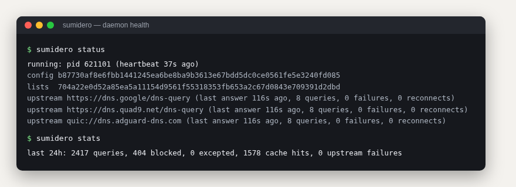
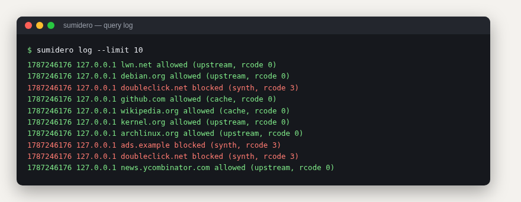
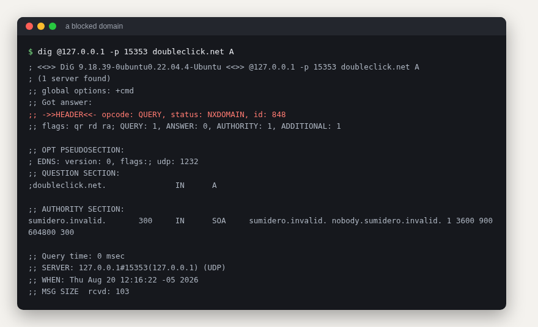

<p align="center"></p>

# sumidero

A DNS blocker for your network, in Rust. One binary, one TOML config, a
SQLite log. No web UI.



## Design position

- **The filesystem is the control plane.** One TOML file, read-only to
  the daemon; `SIGHUP` reloads it. No runtime-rewritten state.
- **Scriptable by contract.** Every subcommand takes `--json` and emits
  a versioned schema; exit codes carry meaning (`status` exits non-zero
  when the daemon is degraded).
- **Failures are loud.** A bad config, an unloadable blocklist, or an
  unbindable address stops startup instead of degrading silently. A bad
  reload keeps the old state; it never half-applies.

## Features

- **List-based blocking**: the ABP-DNS rule subset (`||domain^`, exact,
  `@@` exceptions, wildcards) plus hosts-file lists. Tested with 3.3M
  rules across 6 public lists. Blocked names answer `NXDOMAIN` with a
  synthetic SOA, so clients cache the negative answer. CNAME chains are
  checked too, so a tracker cloaked behind a first-party alias, or a
  neutral name chained to a blocked host, is blocked.
- **Lists that cannot be starved**: downloaded over HTTPS with the list
  host resolved through the encrypted upstreams (never the host
  resolver), validated before they replace the last good copy, refreshed
  daily and hourly while one fails. `status` says which list is stale and
  why.
- **Encrypted upstreams only** (DoH, DoQ). Each miss races all
  configured upstreams; the first usable answer wins. Dead connections —
  including silent hangs — are torn down and rebuilt in the background
  with backoff. An upstream that only answers SERVFAIL counts as down.
- **Cache with serve-stale**: LRU, bounded by entries and by estimated
  bytes (64 MiB) so it fits under a systemd `MemoryMax`. Answers are
  fresh exactly as long as their TTL; expired ones are served (TTL 30)
  for up to 12 h while a background refresh runs (RFC 8767), and a name
  that fails to resolve is held down 5–60 s instead of being retried by
  every client (RFC 9520).
- **Load discipline**: concurrent misses for one name share a single
  upstream lookup; past a hard in-flight cap, queries get an immediate
  SERVFAIL instead of queueing unbounded work.
- **Safe-search enforcement** via CNAME rewrites.
- **SQLite query log and stats**, written off the hot path, with
  retention sweeps; under pressure it drops entries and says how many.
- **Shadow mode**: mirror live traffic to sumidero and your incumbent
  resolver, get a divergence report before switching port 53.
- **Hardened systemd unit** shipped in `packaging/`: `DynamicUser`,
  `ProtectSystem=strict`, syscall filter. `systemd-analyze security`
  scores it 1.6 (OK).



## Numbers

Measured on a 6-core aarch64 SBC with the production rule set (3.0M
rules) and real DoH/DoQ upstreams. Method, and the before/after
record: [docs/PERF.md](docs/PERF.md).

| what | measured |
|---|---:|
| RSS once serving, and after any number of reloads | ~120 MB |
| RSS peak during a reload (two engines coexist) | 317 MB |
| start to serving, lists on disk | 3.9 s |
| cache hit over UDP at 16k qps: p50 / p99 | 0.16 / 0.45 ms |
| blocked name at 8k qps: p50 / p99 | 0.12 / 0.26 ms |
| daemon CPU per cache hit at 16k qps | 57 µs |
| loss at 16k qps, and during a reload under 3k qps | 0 |
| filter verdict on 3.0M rules | 2–3.5 µs |

On misses, answer latency is the upstream's, as for any forwarder —
verified against the same upstreams queried directly
(`crates/core/examples/latency_probe.rs`). Known failure modes found
during validation (dead-connection reuse, hung upstreams, lying health
counters, unbounded admission, a filtering host resolver hiding a
blocklist) each have a reproducing test in the suite.

## Install

Linux with systemd, Rust 1.94+:

```sh
cargo build --release
sudo install -m 0755 target/release/sumidero /usr/local/bin/sumidero
sudo install -d -m 0755 /etc/sumidero
sudo install -m 0644 packaging/sumidero.service /etc/systemd/system/
sudo systemctl daemon-reload
```

`sumidero init` writes a commented starter config; `sumidero migrate`
converts an `AdGuardHome.yaml` and warns about anything it cannot carry
over.

```sh
sudo sumidero --config /etc/sumidero/config.toml init
sudo sumidero --config /etc/sumidero/config.toml check   # validate config + lists
sudo systemctl enable --now sumidero
```

A minimal config:

```toml
[server]
bind = ["0.0.0.0:53", "[::]:53"]
allow = ["192.168.0.0/24", "127.0.0.1/32", "::1/128"]

[filtering]
list_dir = "/var/lib/sumidero/lists"

[[filtering.lists]]
name = "hagezi-pro"
url = "https://cdn.jsdelivr.net/gh/hagezi/dns-blocklists@latest/adblock/pro.txt"

[upstreams]
servers = ["https://dns.google/dns-query", "quic://dns.adguard-dns.com"]
bootstrap = ["1.1.1.1", "9.9.9.9"]
timeout_ms = 5000

[database]
path = "/var/lib/sumidero/sumidero.sqlite"
```

Details, including `DynamicUser` traps and IPv6 bind semantics, are in
[docs/INSTALL.md](docs/INSTALL.md). Replacing a resolver that owns
port 53 today: [docs/CUTOVER.md](docs/CUTOVER.md).

## Day-to-day

```
sumidero status    # health, lists in force, degraded reasons with next steps; exit 7 if degraded
sumidero log       # recent queries: who asked what, verdict, source, rcode
sumidero stats     # aggregates over a window
sumidero explain   # why a domain is (not) blocked, and by which rule
sumidero check     # validate config + lists without touching the daemon
sumidero reload    # SIGHUP the daemon and wait for its outcome
sumidero shadow    # divergence report against a reference resolver
```



## Workspace

| crate | purpose |
|---|---|
| `crates/filter` | pure filter engine (parser + matcher), no I/O |
| `crates/core` | daemon library: server, cache, upstream pool, SQLite |
| `crates/cli` | the `sumidero` binary |
| `crates/testkit` | real local DoH/DoQ upstreams and HTTPS list host for tests |

Design decisions, including rejected ones, are in [DESIGN.md](DESIGN.md).
What happens to each query: [docs/SEMANTICS.md](docs/SEMANTICS.md).
Every runtime state machine: [docs/STATE-MACHINES.md](docs/STATE-MACHINES.md).

## License

MIT
