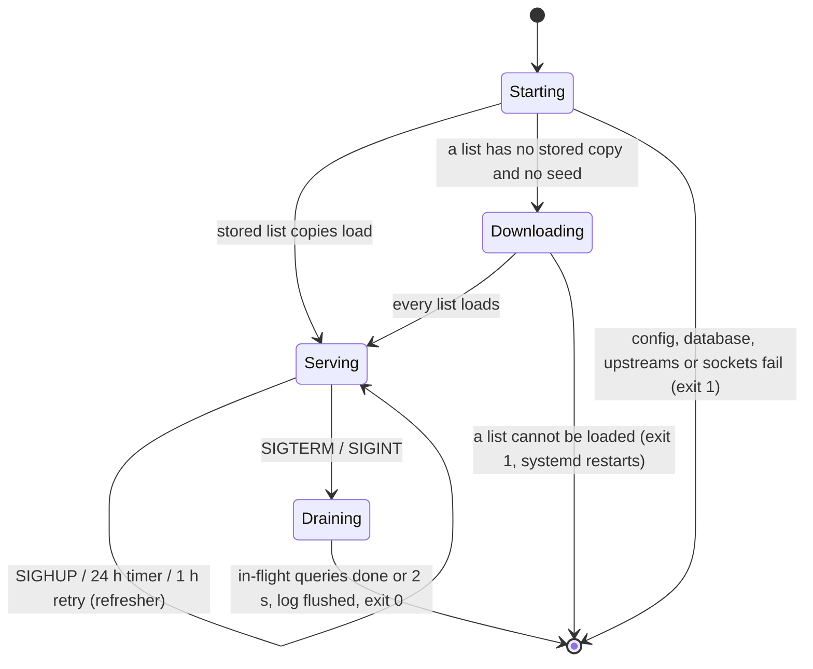
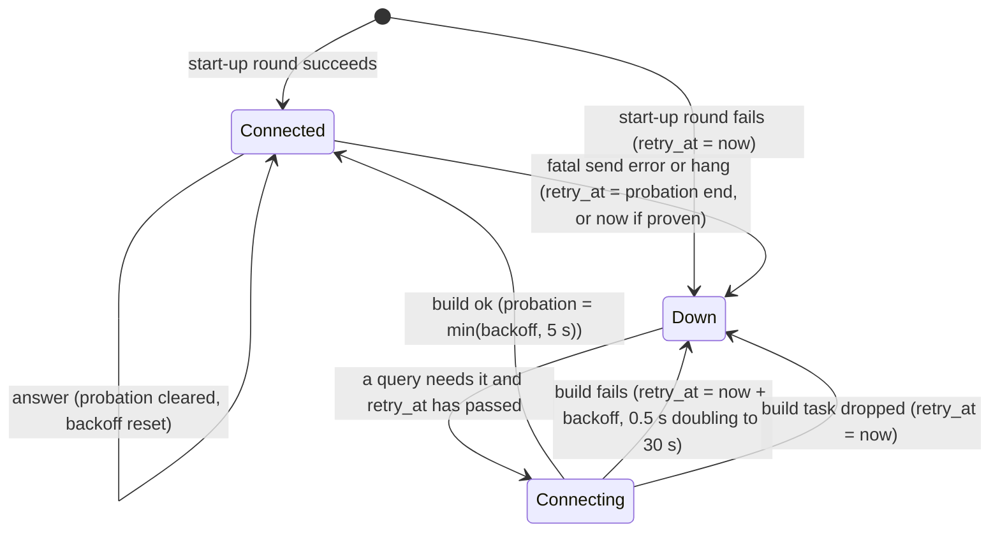
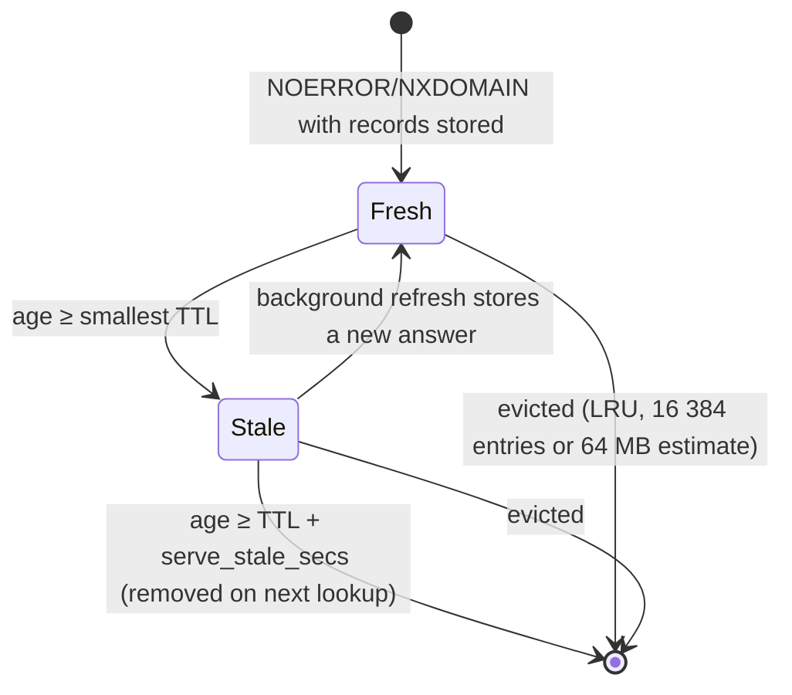
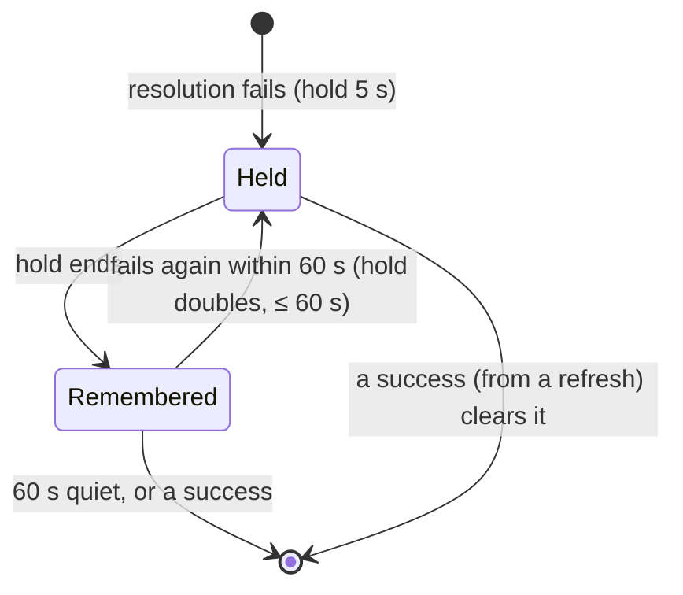

# sumidero — state machines

Every piece of state that changes at runtime, where it lives, who may
change it, and how an operator or agent sees it. There is no other
mutable state: config is read-only, and everything below is either
reported by `sumidero status --json` or written to the query log.

## 1. Daemon lifecycle (`crates/core/src/daemon.rs`)

- **Starting** never binds a socket before a complete policy exists: the
  daemon never serves unfiltered.
- **Serving** owns one `Policy { engine, safe_search, allow }` behind an
  atomic pointer. Only the refresher replaces it, whole.
- The **refresher** is one task. Inputs: a config sent by the SIGHUP
  handler (already parsed and validated), or its timer. It loads every
  list, builds a new policy and installs it in one swap, or keeps the
  policy in force and records why. Its timer is 24 h, or 1 h while some
  list failed to download or the last load failed.
- The signal/heartbeat loop never waits on the network: a download that
  takes minutes cannot delay a heartbeat or a shutdown; shutdown aborts
  a running refresh.

What `status` reports (`daemon_stats`, written when serving starts,
right after every load, and with every heartbeat, once a minute;
upstream counters are as of the last heartbeat):

| field | meaning |
|---|---|
| `lists[]` | name, `origin`, rules, issues, `verified_age_secs` |
| `last_reload` | `ts`, `trigger` (`startup`/`signal`/`timer`), `ok`, `error`, `duration_ms` |
| `pending_restart` | changed settings only a restart applies: `server.bind`, `upstreams`, `database`, `tls`, `cache` |
| `next_refresh_ts` | when the refresher runs next |
| `degraded_reasons[]` | `{reason, detail, next}`; any entry makes `status` exit 7 |

Reason codes: `cannot_resolve`, `log_events_dropped`,
`list_fetch_failed`, `list_stale` (content older than 3 days),
`reload_failed`, `pending_restart`.

`sumidero reload` sends SIGHUP and waits for the matching
`last_reload`: exit 0 applied, 1 failed (old policy in force), 8 no
outcome within `--wait-secs`.

## 2. One upstream connection (`crates/core/src/upstream.rs`)

- One `std::sync::Mutex<ConnState>` per upstream; no lock is held across
  an `.await`. A build runs in a detached task, so a query that loses the
  race and is cancelled never abandons a repair.
- Every connection has a generation; a failure on an old connection
  cannot tear down its replacement.
- A query that finds `Down` before `retry_at` fails that leg at once; one
  that finds `Down` after it starts a build and waits for it within its
  own deadline; one that finds `Connecting` waits. A fatal error on a
  connection is retried once on a fresh connection within the same
  query.
- What is fatal: a dead exchange, I/O and transport errors, a timeout
  (a hang poisons every query multiplexed on the connection), an HTTP
  5xx, and anything unrecognised. What is not: a garbled or refused
  answer, an upstream SERVFAIL/REFUSED/NOTIMP, and an HTTP 4xx such as
  Quad9's `403 DoH dropped query`; those fail the query and count in
  `failures`, and the connection stays.
- Start-up connects every upstream in parallel, in rounds, until at
  least one is up or `connect_budget` (30 s) runs out (then exit 1).
- `status` shows per upstream: `state`, `last_error`,
  `last_success_secs_ago`, `queries`, `failures`, `reconnects`,
  `consecutive_failures`. Only `consecutive_all_failed > 0` (no upstream
  answered the last queries) degrades the daemon: a single upstream
  between connections is normal.

## 3. Cache entry (`crates/core/src/cache.rs`)

## 4. Failure hold-down per key (`crates/core/src/failcache.rs`)

At most 4096 keys are tracked; beyond that, keys quiet for a minute are
pruned first, then the oldest hold.

## 5. In-flight work per key (`crates/core/src/server.rs`)

- **Lookups**: the first miss for a key becomes the leader and spawns the
  upstream lookup; later misses subscribe to its result. The key leaves
  the map before the result is published, however the leader ends.
- **Refreshes**: at most one serve-stale refresh per key; the key leaves
  the set however the refresh ends; a held key is not refreshed.
- **Admission**: a counter of queries inside the pipeline; past 512 the
  next query is answered SERVFAIL at once.
- **TCP**: a semaphore of 128 connection slots.

## 6. Lists on disk (`crates/core/src/lists.rs`)

Per `url` list, in `list_dir`: `<name>.txt` (last good body, replaced by
rename) and `<name>.etag` (written only after its body). The body's
mtime is the moment its content was last confirmed (download or 304).
No other file is written.
